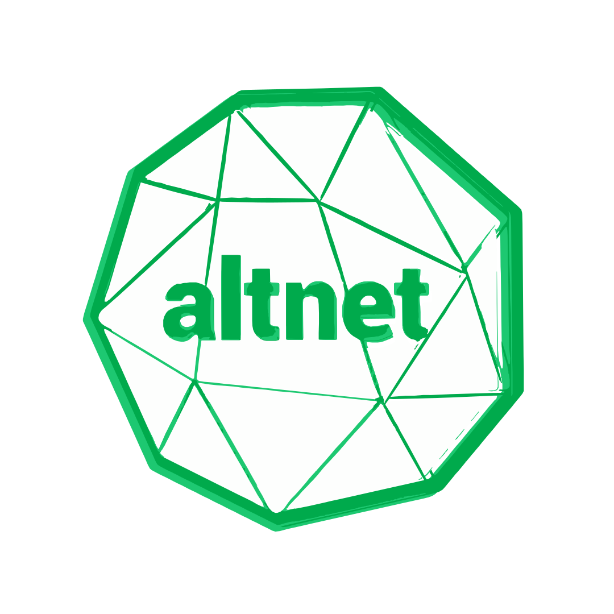

<div align="center">
  

  # Altnet Frontend

  **Modern fiber-optic ISP platform for Moldova**

  [](https://nextjs.org/)
  [](https://www.typescriptlang.org/)
  [](https://tailwindcss.com/)
  [](https://bun.sh/)

  [Demo](https://altnet.md) · [Report Bug](https://github.com/Wayy01/altnet-main/issues) · [Request Feature](https://github.com/Wayy01/altnet-main/issues)

</div>

---

## About

Altnet is a modern, high-performance marketing and storefront platform for a Moldovan Internet Service Provider based in Ialoveni. Built with Next.js 15 and the App Router, it showcases fiber-optic internet services, TV packages, and telecommunications offerings with a beautiful, animated user interface.

### Key Features

| Feature | Description |
|---------|-------------|
| **Speed Test** | LibreSpeed-powered tool with download, upload, ping & jitter measurements |
| **Dynamic Pricing** | Real-time pricing from backend API with ISR (5-min revalidation) |
| **Product Catalog** | Full e-commerce catalog with multi-currency pricing & promotions |
| **Coverage Checker** | Interactive coverage area display for service availability |
| **Contact System** | Multi-channel contact with form submission & email integration |
| **Smooth Animations** | Framer Motion powered animations throughout |

---

## Tech Stack

<table>
<tr>
<td align="center" width="96">

<br>Next.js 15
</td>
<td align="center" width="96">

<br>React 19
</td>
<td align="center" width="96">

<br>TypeScript
</td>
<td align="center" width="96">

<br>Tailwind CSS
</td>
<td align="center" width="96">

<br>Bun
</td>
</tr>
</table>

### Additional Technologies

- **Radix UI** - Accessible headless components
- **Framer Motion** - Animation library
- **React Hook Form + Zod** - Form handling & validation
- **Nodemailer** - Email integration
- **Embla Carousel** - Touch-friendly carousels

---

## Getting Started

### Prerequisites

- [Bun](https://bun.sh/) (recommended) or Node.js 18+
- Access to the Altnet backend API

### Installation

1. **Clone the repository**
   ```bash
   git clone https://github.com/Wayy01/altnet-main.git
   cd altnet-main
   ```

2. **Install dependencies**
   ```bash
   bun install
   ```

3. **Set up environment variables**
   ```bash
   cp .env.example .env.local
   ```

   Configure the required variables:
   ```env
   NEXT_PUBLIC_API_BASE_URL=http://localhost:8080
   NEXT_PUBLIC_SITE_URL=https://altnet.md
   ```

4. **Start the development server**
   ```bash
   bun dev
   ```

5. **Open [http://localhost:3000](http://localhost:3000)** in your browser

---

## Project Structure

```
src/
├── app/                    # Next.js App Router
│   ├── page.tsx            # Homepage
│   ├── preturi/            # Pricing pages
│   ├── pachete/[slug]/     # Package details & ordering
│   ├── produse/[slug]/     # Product catalog pages
│   ├── acoperire/          # Coverage area
│   ├── servicii/           # Services overview
│   ├── contact/            # Contact form & info
│   └── api/                # API routes
│
├── components/
│   ├── layout/             # Header, Footer, Layout
│   ├── sections/           # Homepage sections
│   ├── speedtest/          # Speed test components
│   ├── pricing/            # Pricing cards
│   ├── products/           # Product components
│   ├── services/           # Service cards
│   └── ui/                 # Reusable UI components
│
├── lib/                    # Utilities & API helpers
│   ├── backend-api.ts      # API configuration
│   ├── speedtest-engine.ts # Speed test logic
│   └── utils.ts            # General utilities
│
├── types/                  # TypeScript definitions
└── data/                   # Static/mock data
```

---

## API Integration

The frontend connects to a Go backend API:

| Endpoint | Description |
|----------|-------------|
| `/api/v1/public/service-packages` | Pricing plans & packages |
| `/api/v1/public/products` | Product catalog |
| `/api/v1/public/service-orders` | Order submissions |

**Configuration:** Set `NEXT_PUBLIC_API_BASE_URL` in your environment.

See `api-documentation.md` for complete API reference.

---

## Available Scripts

| Command | Description |
|---------|-------------|
| `bun dev` | Start development server (0.0.0.0:3000) |
| `bun run build` | Create production build |
| `bun start` | Start production server |
| `bun lint` | Run ESLint |

---

## Environment Variables

| Variable | Required | Description |
|----------|----------|-------------|
| `NEXT_PUBLIC_API_BASE_URL` | Yes | Backend API base URL |
| `NEXT_PUBLIC_SITE_URL` | No | Site URL for metadata (default: https://altnet.md) |
| `NEXT_PUBLIC_GOOGLE_VERIFICATION` | No | Google Search Console verification |

---

## Contributing

Contributions are welcome! Please feel free to submit a Pull Request.

1. Fork the repository
2. Create your feature branch (`git checkout -b feature/amazing-feature`)
3. Commit your changes (`git commit -m 'Add amazing feature'`)
4. Push to the branch (`git push origin feature/amazing-feature`)
5. Open a Pull Request

---

## License

This project is proprietary software. All rights reserved.

---

<div align="center">
  <p>Built with ❤️ in Moldova</p>
  <p>
    <a href="https://altnet.md">Website</a> •
    <a href="mailto:sales@altnet.md">Contact</a>
  </p>
</div>
